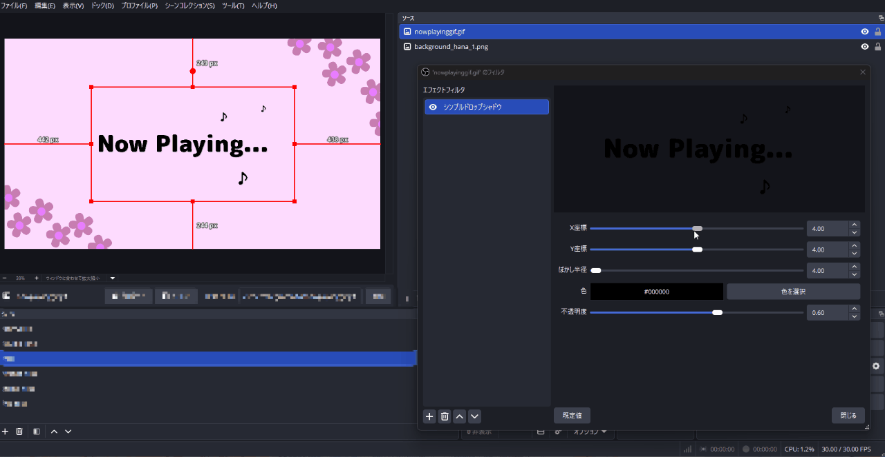

# Simple Drop Shadow Plugin for OBS Studio

OBS Studio 向けのシンプルなドロップシャドウフィルタプラグインです。

A simple drop shadow filter plugin for OBS Studio.



## Features / 機能

映像ソースに影を追加するエフェクトフィルタです。影はソースの外側まで描画され、フィルタの出力は影の分だけ広がります。ぼかしはガウシアンに近い柔らかな形で、半径 1024 でも 1080p のソースで 1ms 前後の GPU 時間に収まります (RTX 3060 Ti で測定)。

- **X Position / X座標** - 影の水平方向オフセット
- **Y Position / Y座標** - 影の垂直方向オフセット
- **Blur Radius / ぼかし半径** - 影がぼけて届く距離
- **Color / 色** - 影の色
- **Opacity / 不透明度** - 影の透明度

X座標・Y座標・ぼかし半径・不透明度はスライダーで操作できます。スライダーの横の数値欄に直接入力することもできます。

## Installation / インストール

### Windows

v0.1.2以降のWindows版はOBS Studio 33以降向けです。OBS Studio 33.0.1で新規導入と旧版からの更新、設定保持、影の描画を確認しています。OBS Studio 32以前を使用する場合は、[v0.1.1の配布ページ](https://github.com/AllegroMoltoV/obs-simple-drop-shadow/releases/tag/v0.1.1)から入手してください。旧版のすべてのOBSバージョンでの動作を保証するものではありません。

#### 通常版OBSへの新規導入

プラグインをOBS Studioの共通プラグインフォルダーへ配置します。

1. OBS Studioを終了してください。
2. [Releases](../../releases)からWindows用のzipファイルをダウンロードし、展開してください。
3. エクスプローラーのアドレスバーへ`%PROGRAMDATA%`を入力し、Enterキーを押してください。隠しフォルダーの表示設定を変更する必要はありません。
4. `obs-studio`フォルダーを開き、その中の`plugins`フォルダーを開いてください。存在しないフォルダーを順に作成してください。
5. 展開した`simple-drop-shadow`フォルダーを`plugins`へコピーしてください。管理者の許可を求められた場合は許可してください。
6. OBS Studioを起動し、映像ソースのエフェクトフィルターへシンプルドロップシャドウを追加してください。

導入後の構成を次に示します。`simple-drop-shadow`フォルダーを二重に作らないでください。PDBファイルが同梱されている場合も、製品フォルダーごとコピーします。

```text
%PROGRAMDATA%\obs-studio\plugins\
└─ simple-drop-shadow\
   ├─ simple-drop-shadow.dll
   └─ data\
      ├─ effects\drop-shadow.effect
      └─ locale\
         ├─ en-US.ini
         └─ ja-JP.ini
```

#### 旧版からの更新

OBS Studioを終了し、新規導入と同じ手順で`simple-drop-shadow`フォルダーを上書きコピーしてください。既存のフィルター設定を保持するため、OBS Studioの設定やシーンを削除しないでください。他のプラグインも削除しないでください。

v0.1.1の`simple-drop-shadow\bin\64bit`が残っていても、新配置のDLLが読み込まれます。

OBS Studioのインストール先へ手動配置した場合は、旧版zipの内容と照合し、この製品の`obs-plugins\64bit\simple-drop-shadow.dll`と`data\obs-plugins\simple-drop-shadow`をOBS Studioの外へバックアップして移してから、新配置へ導入してください。同梱のPDBを手動配置していた場合も同様に移します。OBS Studio本体のファイルや`obs-plugins`フォルダー全体を削除しないでください。

#### ポータブル版OBS

ポータブル版では、OBS Studioのルートフォルダーにある`plugins`へ製品フォルダーをコピーします。通常版の`%PROGRAMDATA%`への導入では読み込まれません。

OBS Studioを終了し、`bin`や`data`と同じ階層に`plugins`フォルダーを作成してください。展開した製品フォルダーをコピーし、`plugins\simple-drop-shadow\simple-drop-shadow.dll`と`plugins\simple-drop-shadow\data`を配置してからOBS Studioを起動します。

### macOS / Linux

macOS / Linux 向けのビルドは GitHub Actions で生成しています。v1.0.0 では、GitHub Actions 上の Ubuntu 24.04 (Mesa の OpenGL) と macOS 15 (Apple Software Renderer の OpenGL) で影の描画を自動で検証しています。作者は macOS と Linux の実機を持たないため、実機の GPU と OBS Studio では動作を確認していません。macOS の OBS Studio 32 以降で選べる試験的な Metal 描画も確認していません。

v0.1.2 以前は、OpenGL で影のシェーダーをコンパイルできず、macOS と Linux では影が描画されていなかった可能性があります。v1.0.0 で修正しました。

## Usage / 使い方

1. OBS Studio を起動
2. 映像ソースを右クリック → **フィルタ**
3. エフェクトフィルタの **+** ボタン → **Simple Drop Shadow** (または **シンプルドロップシャドウ**) を追加
4. パラメータを調整

## Parameters / パラメータ

| Parameter | 日本語 | Range | Default |
|-----------|--------|-------|---------|
| X Position | X座標 | -1024 ~ 1024 | 4.0 |
| Y Position | Y座標 | -1024 ~ 1024 | 4.0 |
| Blur Radius | ぼかし半径 | 0 ~ 1024 | 4.0 |
| Color | 色 | - | Black |
| Opacity | 不透明度 | 0 ~ 1 | 0.6 |

## Known Behavior / 既知の挙動

v1.0.0 では、影をソースの外側まで描画するため、フィルタの出力を影がはみ出す辺にだけ広げます。X座標・Y座標・ぼかし半径を変えたときや、フィルタを追加・削除したとき、目のアイコンで有効・無効を切り替えたときは、出力の大きさが変わります。このときフィルタは、そのソースを置いたすべてのシーンのアイテムについて、位置とバウンディングボックスを補正します。フィルタの追加・削除・有効化・無効化で補正したときは、理由と余白の変化を OBS のログへ記録します。元画像のシーン上の位置と大きさは保たれます。OBS はアイテムの位置を 0.5 画素単位で描くため、0.25 画素までのずれは生じます。

次の場面では、補正が働かないか、見え方が変わります。

- v0.1.2 以前から更新した直後に初めてシーンを開いたとき、ぼかし半径が X座標・Y座標より大きい設定や、X座標・Y座標が負の設定では、元画像が余白の分だけ一度右や下へずれます。既定値の X座標 4・Y座標 4・ぼかし半径 4 ではずれません。ずれた位置から配置し直せば、以降は補正されます。
- アイテムのクロップは出力の端からの切り取りとして扱います。余白が変わると、切り取られる部分は影の余白と元画像の間で移ります。
- バウンディングボックスの「クロップをボックスに合わせる」を有効にしている場合、ボックスからはみ出す部分の扱いは補正の対象外です。
- 1 つのソースにこのフィルタを 2 つ以上付けた場合や、出力の大きさを変えるほかのフィルタと組み合わせた場合の補正は、確認していません。中央揃えやバウンディングボックスを使うアイテムでは、補正がずれる場合があります。
- ほかのプラグインが内部に持つ非公開のシーンのアイテムは補正されません。Move transition などのプラグインがアイテムの位置を動かしている最中に設定を変えた場合も、補正が意図どおりにならないことがあります。
- v0.1.2 以前の影は、縁が直線的に薄くなる箱型のぼかしでした。v1.0.0 ではガウシアンに近い形になり、同じぼかし半径でも影の中心付近がやや濃く、縁がより柔らかく見えます。影が届く距離は、従来と同じくぼかし半径です。

## Build / ビルド

### Requirements / 必要環境

| Platform | Tool |
|----------|------|
| Windows | Visual Studio 17 2022 |
| Windows | CMake 3.28+ |
| macOS | Xcode 16.0, CMake 3.28+ |
| Ubuntu 24.04 | ninja-build, pkg-config, build-essential, CMake 3.28+ |

### Build Commands / ビルドコマンド

```bash
# Windows
cmake --preset windows-x64 -DENABLE_POST_BUILD_INSTALL=OFF
cmake --build build_x64 --config RelWithDebInfo

# macOS
cmake --preset macos
cmake --build build_macos --config RelWithDebInfo

# Ubuntu
cmake --preset ubuntu-x86_64
cmake --build build_x86_64 --config RelWithDebInfo
```

Windowsで生成物を取り出すには、`cmake --install build_x64 --config RelWithDebInfo --prefix release/RelWithDebInfo`を実行してください。生成した製品フォルダーを前述の手順で導入してください。

## AI利用開示 / AI Disclosure

### 日本語

v0.1.0までの制作では、Anthropic Claude Codeをソースコード、ビルド設定、テスト、文書を含むほぼすべての工程で使用しました。その後の修正では、OpenAI Codexを同様にほぼすべての工程で使用しました。プロジェクトREADMEとOBS Forum掲載文の作成・改稿にもCodexを使用しています。

v1.0.0では、描画方式の調査・実装・テスト・文書を含むほぼすべての工程でAnthropic Claude Codeを使用しました。

作者本人はWindows上のOBS Studioでユーザーテストを実施しました。コード読解による厳密な人間レビューは実施していません。リソースアイコンはOpenAI Codexが出力したSVGから作成しました。概要説明欄のアニメーションGIFは、作者本人がScreenToGifで画面収録したもので、生成AIを使用していません。

### English

Anthropic Claude Code was used for almost the entire development process through v0.1.0, including source code, build configuration, tests, and documentation. OpenAI Codex was used in a similar capacity for almost all subsequent revisions. Codex was also used to draft and revise the project README and OBS Forum resource description.

For v1.0.0, Anthropic Claude Code was used for almost the entire process, including research on the rendering method, implementation, tests, and documentation.

The author performed user testing in OBS Studio on Windows but did not perform a rigorous human review of the source code. The resource icon was created from an SVG generated by OpenAI Codex. The animated GIF in the resource description was screen-recorded by the author using ScreenToGif, without generative AI.

## License / ライセンス

GPL-2.0 License

このプラグインは [obs-plugintemplate](https://github.com/obsproject/obs-plugintemplate) をベースにしています。

## Author / 作者

AllegroMoltoV - https://www.allegromoltov.jp

## Changelog / 更新情報

### v1.0.0 (2026-11-09)

- X座標・Y座標・ぼかし半径をスライダーで操作できるようにしました。範囲は X座標・Y座標が -1024 から 1024、ぼかし半径が 0 から 1024 です。
- 影のぼかしを、縮小と拡大を繰り返す Dual Kawase 方式へ置き換えました。半径 1024 でも 1080p のソースで約 0.8ms の GPU 時間です。従来の方式では、半径 1024 相当で約 36ms かかっていました。いずれも RTX 3060 Ti で測定しました。
- 影をソースの外側まで描画するようにしました。影の設定を変えて出力の大きさが変わっても、シーン上の元画像の位置と大きさが保たれるよう、アイテムの位置を自動で補正します。補正が働かない場面は「既知の挙動」を参照してください。
- フィルタの表示名を「シンプルドロップシャドウ」(英語環境では Simple Drop Shadow) に変更しました。追加済みのフィルタの名前は変わりません。
- OpenGL で影のシェーダーをコンパイルできず、macOS と Linux で影が描画されなかった可能性がある不具合を修正しました。

### v0.1.2 (2026-11-07)

- Windows 版を OBS Studio 33 の新しいプラグイン配置へ移行しました。

### v0.1.1 (2026-09-19)

- 影のぼかしを横方向と縦方向の 2 パスに分け、大きなぼかし半径での処理量を減らしました。

### v0.1.0 (2026-01-04)

- 最初の公開版です。
